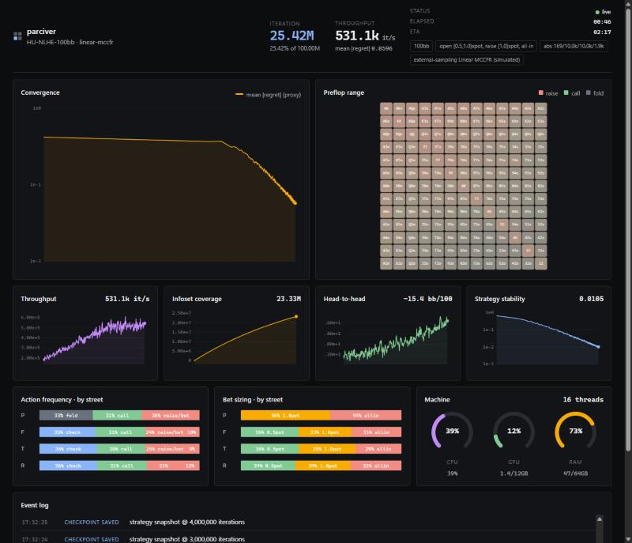

# parciver

A heads-up **No-Limit Texas Hold'em** bot built from scratch with **Counterfactual Regret Minimization**:
a Rust Monte Carlo CFR blueprint, GPU real-time subgame search on top of it, and a validation ladder that
checks every solver against games with known answers before it is trusted on poker. Developed and measured on
one consumer desktop (RTX 4070, Ryzen 5800X); see [Scope](#scope-and-honesty) for the few jobs that were not.

**Play it in your terminal:**

```bash
pip install -e .                      # Python side
parciver play kuhn                    # nothing else to install, instant
parciver play leduc --peek            # watch the exact equilibrium it solved a moment ago
```

and, after the one-time ~0.7 GB download of the real blueprint (see [Play](#play)):

```bash
parciver fetch-blueprint
parciver play nlhe                    # heads-up no-limit hold'em, 200 big blinds deep
```

## What is in here

| | |
|---|---|
| **Solvers** | Tabular CFR family (vanilla, CFR+, Linear, DCFR) in Python and Rust, cross-validated to 1e-6; external-sampling Linear MCCFR in Rust for the full game, parallel across cores |
| **Exact checks** | Best-response exploitability on Kuhn (game value -1/18) and Leduc (288 information sets); a 7-card hand evaluator certified against all 133,784,560 hands |
| **Abstraction** | Suit-isomorphism (169 preflop classes, exact), then k-means card buckets: 10,000 flop, 10,000 turn, 1,950 river; a 200 bb bet grid with pot-fraction raises and all-in |
| **Blueprint** | 8 billion MCCFR iterations of the abstracted game (`v2-8B`, 200 bb) |
| **Real-time search** | Depth-limited subgame solving on the GPU (PyTorch + Triton kernels): flop with a learned value net at the leaves, turn and river solved to the end of the hand |
| **Measurement** | A chip-linear strength rating with exact standard errors and AIVAT variance reduction, a local-best-response exploitability estimator, and a live benchmark client for the Slumbot server |
| **Method** | Every experiment pre-registered before its data existed (post-data amendments are labelled as such); the registrations and results are in [`records/`](records) |

## How strong is it?

Short answer: **competitive within noise of a 2018 competition winner, and not shown to beat it.** The results
below are the whole story, including the ones that did not come out in the bot's favour.

| measurement | result | what it means |
|---|---|---|
| **Slumbot, 50,000 hands, live config of 25 Oct 2026** (8B blueprint, flop net N0) | **-12.54 bb/100, 95% CI [-26.41, +1.33]** | Slumbot (the 2018 ACPC winner) is run by a third party over HTTP. The interval includes zero: the result is *unresolved*, not a win and not a proven loss. Pre-registered rule, read as pre-registered. |
| Slumbot, 50,000 hands, earlier config (no flop search) | -1.54 bb/100, [-15.00, +11.91] | also unresolved. The difference between the two runs is -10.99 [-30.32, +8.33]: also within noise. |
| **parciver rating (PR)** | live bot **1860.4** [1771.4, 1949.4]; blueprint alone 1665.6; v1 100 bb blueprint 1500 by definition | chip-linear, paired deals, Nash-averaged anchor pool, AIVAT. 1 point = 1 mbb/hand. Rated before the 8B blueprint, the 2,000-iteration river and the flop-net upgrades that came later. |
| Search vs blueprint-only | on the rating scale the live bot sits ~195 points above its own 2B-iteration blueprint | search is doing real work |
| Latency (SLUMBOT-2 live run, 71,853 searched decisions) | flop median 2.3 s / p95 2.7 s, turn 0.9 / 0.9 s, river 0.16 / 0.17 s | inside the project's own 3 s per-decision bar (5 flop decisions passed it); not a Slumbot-imposed limit |

Why it matters that the Slumbot result is unresolved: a 50,000-hand match at this variance resolves roughly
+/-14 bb/100, so only a large edge either way would have been visible. The honest reading is "within noise
of a 2018 competition winner, not shown to beat it". Details, the hand-by-hand logs and the arithmetic
checks are in [RESULTS.md](RESULTS.md); the match logs themselves are in `records/slumbot*/hands.jsonl.xz`.

## Play

Three tiers, from "works in ten seconds" to "the full system":

1. **`parciver play kuhn|leduc`**: no downloads. The opponent is solved with CFR when you start, then the
   session prints its **exact exploitability** (how much a perfect opponent could win from it) and, with
   `--peek`, the mixed strategy it used at each decision. This is the bot's validation ladder, playable.
2. **`parciver play nlhe`**: heads-up no-limit hold'em against the 8-billion-iteration blueprint, on the
   CPU, with Slumbot's rules (50/100 blinds, 20,000-chip stacks, seats alternate). Decisions are instant.
   Add `--search` to have it re-solve the turn and river on the CPU (about ten seconds per decision).
   It reads your real bet sizes by nearest-size translation, so you can bet any amount: `b 640`, `h`
   (half pot), `p` (pot), `a` (all in). It is a fixed strategy: it does not read or adapt to you.
3. **The full GPU configuration** (flop value-net search + turn/river search), as benchmarked in
   [RESULTS.md](RESULTS.md): see [ARCHITECTURE.md](ARCHITECTURE.md) and `scripts/slumbot_run.py`. Needs an
   NVIDIA GPU and `pip install -e ".[gpu]"`.

`parciver fetch-blueprint` (available once the release assets are published; until then the command reports that no download location is set) downloads the blueprint tables (1.55 GB unpacked, ~0.7 GB to download) from the
project's GitHub release, decompresses them on the fly and **verifies a SHA-256 of every file before
installing it**. The tables are numeric data read by the Rust engine; nothing downloaded is ever executed.
They go to `~/.parciver` (or `$PARCIVER_HOME`).

## Install

Requires Python 3.12+ and a Rust toolchain (the engine is a PyO3 extension built with maturin). Developed and
tested on Windows 11; CI also builds and tests on Linux.

```bash
python -m venv .venv && . .venv/bin/activate        # Windows: .venv\Scripts\activate
pip install -e ".[dev]"
pip install maturin && maturin develop --release -m engine/Cargo.toml
pytest                                              # the CPU test suite
cargo test --no-default-features --manifest-path engine/Cargo.toml
```

`parciver play kuhn` and `leduc` work with the first line alone; `play nlhe` and most of `scripts/` need the
Rust extension. GPU search additionally needs `pip install -e ".[gpu]"` with a CUDA build of PyTorch.

## The training dashboard

A local web app that tails a run's append-only telemetry log: convergence, the 13x13 preflop range, throughput
and coverage, strategy stability, action frequencies by street, and machine load. It only reads the log, so it
cannot slow a solve. Try it on a simulated full-scale run, no data needed:

```bash
python scripts/dashboard.py --demo full
```



## Layout

```
engine/          Rust: game engine, hand evaluator, MCCFR, abstraction, exploitability, LBR (PyO3 -> parciver_engine)
src/parciver/    Python: solvers, games, GPU search, value nets, rating, play layer (cli.py), dashboard
scripts/         experiment drivers, the live Slumbot runner, rating, audits
tests/           CPU test suite (GPU tests skip themselves without a GPU)
records/         pre-registrations, results, machine-readable receipts for every quoted number
docs/            condensed design notes: flop search, GPU kernels, rating, verification, translation;
                 CONTINUING.md = what is and is not new, and the open leads for anyone picking this up
```

## Method

Silent correctness bugs are the number-one way CFR projects fail, so the project is organised around not
trusting itself:

- **Validation ladder.** A solver reaches hold'em only after it reproduces known equilibria on Kuhn and Leduc
  with an *independent* exact best-response oracle, and the Rust port matches the Python reference.
- **Pre-registration.** Each experiment's hypothesis, sample size and pass rule were committed *before* any
  data. Results are filed beside them in `records/<topic>/` as `PREREG.md` and `RESULT.md`, including the
  negative ones: several ideas (a leaf net, flop update schedules, a translation fix, GPU kernel variants) did
  not pass their own gates and were not adopted.
- **Receipts.** Quoted numbers trace to a write-up or a machine-readable file in `records/`; a handful live only
  in a write-up's prose. Machine-specific process lists and absolute paths were removed from the public copy, so
  the sha256 digests cited in prose match only the files that were not rewritten (see [records/README.md](records/README.md)).
- **Bit-identical changes.** Speed work is held to "same result to the bit" or an oracle test, never traded
  against precision.

## How it was built

This is an AI-assisted project, and the workflow is part of what it demonstrates. The author set the goals,
wrote the pre-registered pass rules, and made every go/no-go call (adopt a method, drop it, spend GPU time).
An AI coding assistant (Anthropic's Claude, through Claude Code) did most of the implementation, ran the
experiments, and proposed designs and operationalisations; where it, rather than the author, chose a number,
the notes in `records/` say so. Every change had to pass the gates above (oracle tests, bit-identical checks,
pre-registered rules) and was audited by a second, read-only review pass before it counted. The point of the
method is that the result does not depend on trusting either collaborator.

## Scope and honesty

Almost all compute ran on that one desktop. Two exceptions are recorded in `records/`: a longer
12.3-billion-iteration blueprint (not the one in use) was trained on rented cloud CPU cores, and 372 of the 501 shards of
the extra turn-start data (D1b) behind the current flop net were produced on a rented cloud GPU, once. One GPU and 16 CPU
threads do not reproduce Libratus or Pluribus, which used thousands of cores. This is a
competitive bot built from a good abstraction plus real-time search, not a from-scratch superhuman solve, and it
is heads-up only. `rmapss*` in `src/` and `scripts/` is a closed multiplayer-exploitation research track kept
for its recorded negative results (its later pre-registered gates failed); it is not part of the bot.

## License

MIT, see [LICENSE](LICENSE). Want to continue the work? Start at [docs/CONTINUING.md](docs/CONTINUING.md).
